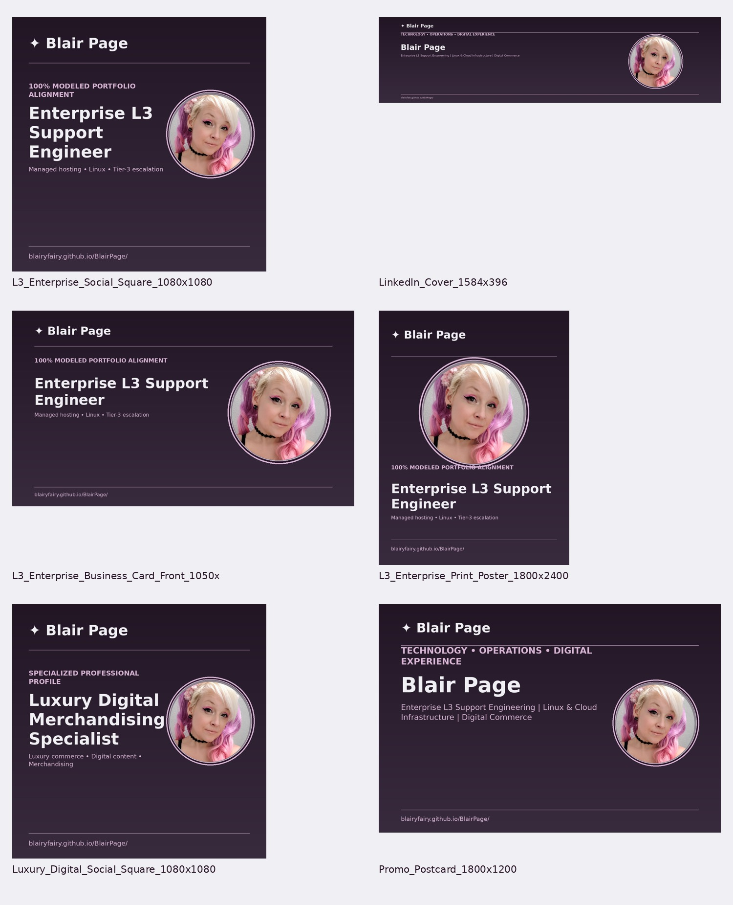

# ✦ Blair Page — Master Brand Identity & ATS-Aligned Career Portfolio

**2026 GitHub-ready visual identity system** · Signature lavender gemstone · Pink/purple-haired circular portrait · Midnight-violet and mauve editorial identity.

## Primary positioning
**Enterprise L3 Support Engineer · Escalation L3 Support Engineer · L3 Linux Managed Applications Support Engineer**

Brand extensions: Linux/managed hosting, AWS/cloud infrastructure, MySQL/Percona databases, WordPress/WooCommerce/Magento, technical solutions, digital product strategy, and luxury digital commerce.

## Source and accuracy
Built from `08_ATS_Data/Source_ATS_Differential.html` (500 modeled 95–100% titles) and `08_ATS_Data/Source_Portfolio_Index.html` (uploaded latest portfolio). The 12 100%-modeled matches are **not verified hiring-system scores**. Role titles are positioning targets, not proof of employment or supervisory duties. Mentoring/team-lead responsibility is not established solely by training credentials.

## Brand standards
- **Gemstone:** original user-provided logo artwork in `13_Logo_System/`.
- **Portrait:** `01_Identity/Portrait_Master_Transparent.png`, exactly centered in a true transparent circle, with no rectangular image corners.
- **Colors:** Midnight violet `#291528`, deep ink `#17121B`, charcoal `#3A3E3B`, dusty mauve `#9E829C`, pale orchid `#D8B4D5`, ghost white `#F0EFF4`.
- **Type:** DejaVu Sans Bold / Arial Bold headings; Arial / Helvetica body; system-font declarations only. No redistributed font binaries.
- **Responsive:** use the supplied CSS, editable SVG and HTML templates.

## Directory
| Folder | Contents |
|---|---|
| `00_START_HERE` | Link directory and quick-start |
| `01_Identity` | Circular portrait master and sizes |
| `02_Social` | Social squares, banners, stories, thumbnails, hero |
| `03_Business_Cards` | Role-specific front and back images |
| `04_Flyers_Posters` | 12 role-specific posters |
| `05_Stationery` | Letterhead image |
| `06_Web` | Responsive profile website |
| `07_Presentation` | Role-specific slide title art |
| `08_ATS_Data` | All 500 titles in CSV/JSON, source HTML, score positioning matrix |
| `09_Brand_Guidelines` | Identity rules |
| `10_Previews` | Visual contact sheet and inventory |
| `11_Promotional` | Media sheet, promo, event sign, bios |
| `12_Print_Ready` | Existing print references; verify printer bleed before production |
| `13_Logo_System` | Uploaded original logo art, variants, SVG wordmark |
| `14_Design_Tokens` | CSS, JSON, Figma CSV, Tailwind colors, type scale |
| `15_Templates_Editable` | SVG social card, email signature, letterhead, headline bank |
| `16_Iconography` | PNG favicon sizes, ICO, web manifest |
| `17_Swatches` | Palette board |
| `18_Repository_Config` | Maintenance, asset rights, gitignore |
| `19_QR_Codes` | Portfolio and ATS title QR graphics |
| `20_Audits` | File/portrait checks and manifest |

## Usage
1. Use the `01_Identity` transparent PNG as the *single portrait master*.
2. Choose role-specific assets matching the job application; lead with exact 100% modeled titles only where relevant.
3. Customize `15_Templates_Editable` or `06_Web/index.html` for new campaigns.
4. Import `14_Design_Tokens/brand.css` to maintain consistent colors and typography.
5. Check text contrast, print bleed, link validity, and ATS wording before publishing.

## Portfolio links
- [Official portfolio](https://blairyfairy.github.io/BlairPage/)
- [ATS title research](https://blairyfairy.github.io/BlairPage/Blairs_Job_Titles_ATS.html)
- [Portfolio card](https://blairyfairy.github.io/portfolio-card/)

Full extracted website link directory: `00_START_HERE/Portfolio_Link_Directory.csv`.

## Asset rights
Portraits, supplied gemstone art and personal branding remain personal assets; no blanket third-party license is granted. Fonts are named via CSS, not bundled.
